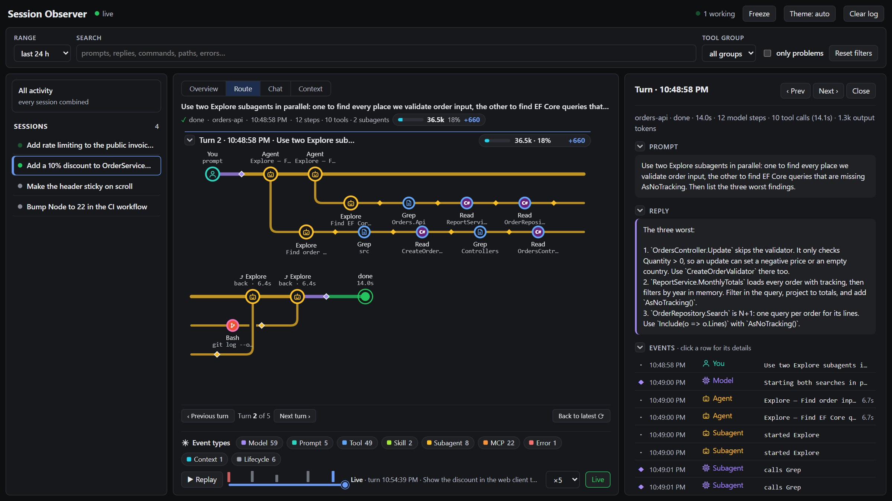
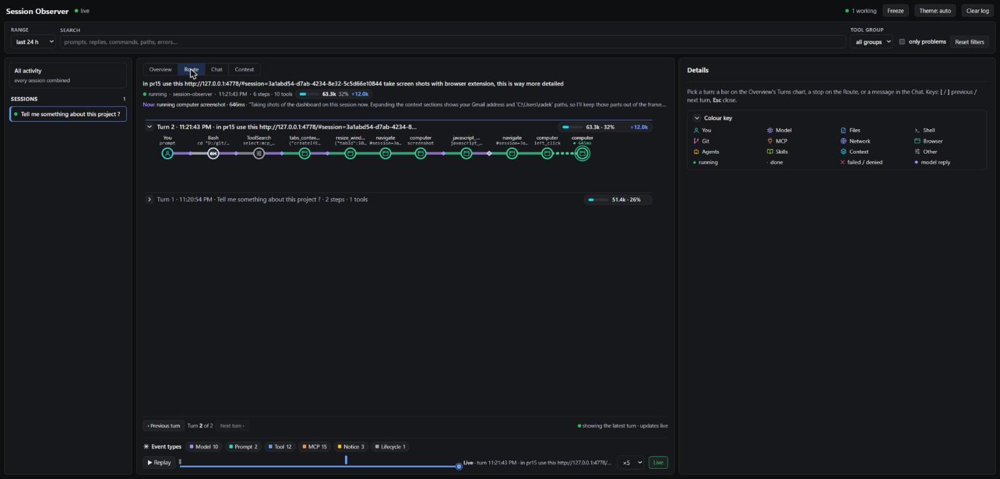
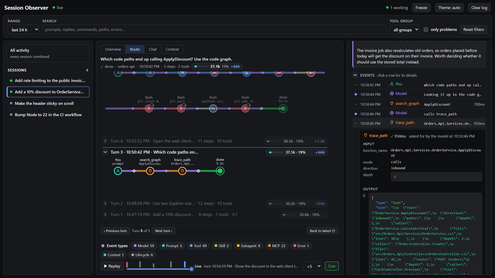
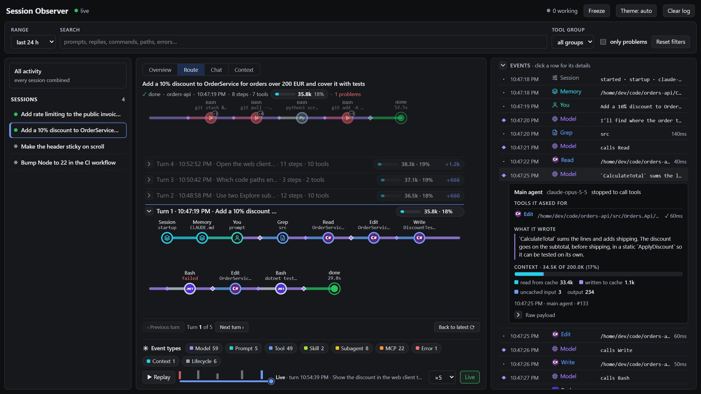
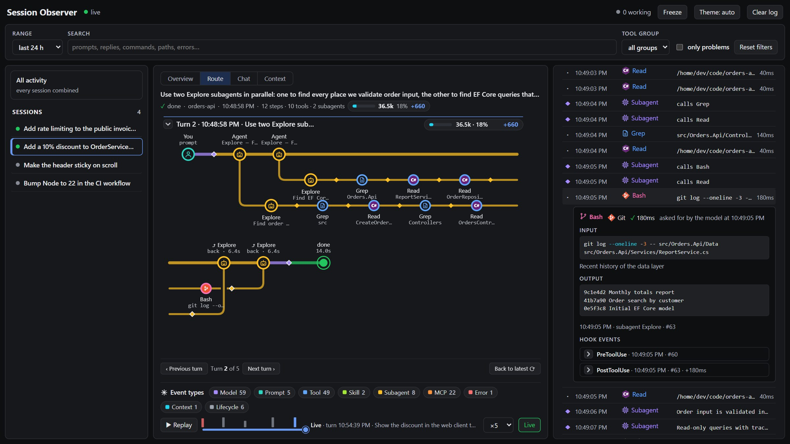
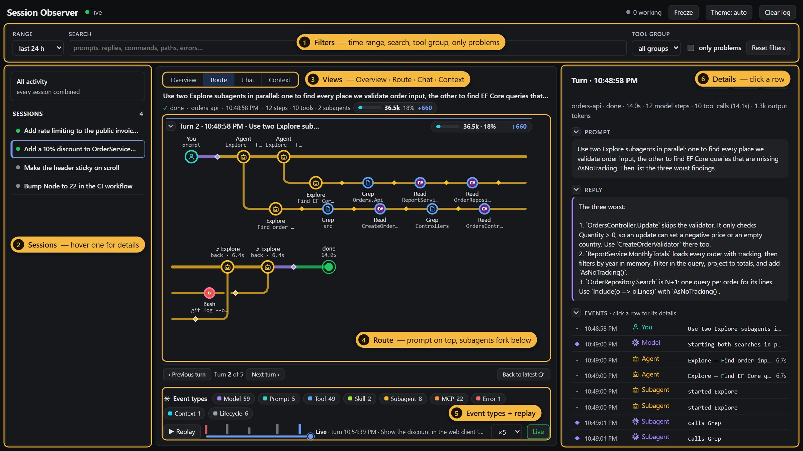

# Session Observer — a Claude Code plugin

[](https://github.com/radekwojpl2/session-observer/actions/workflows/ci.yml)

See everything that happens in your Claude Code sessions on a live local dashboard:
prompts, every tool call (with timing), **skills loaded**, **questions Claude asks you**
(AskUserQuestion + MCP elicitations), subagents, tasks, MCP calls, permission prompts,
failures, notifications, context compactions, model switches, file/cwd changes,
token usage per session, and what the model wrote and which tools it asked for at each step.



## Quick start

Needs Node.js 18+ and Claude Code. No `npm install`.

```bash
git clone https://github.com/radekwojpl2/session-observer.git
claude --plugin-dir ./session-observer      # start Claude Code with the plugin loaded
```

Open **http://localhost:4777** (the server starts on the first session start), or run
`/session-observer:dashboard` inside Claude Code.

**Just want to look?** `node scripts/demo.js` serves made-up sessions, one of them still
working, on **http://localhost:4800**. It doesn't touch `~/.claude`.

### Screenshots

All taken from one real session.

**Overview**


Totals up top. One bar per turn. Context use over time. Busiest tool groups.

**Route: two subagents in parallel** (top of this page)

Two Agent calls fork into two lanes. Each lane is one subagent and its tools. They merge back when they report.

**Route: a browser turn**



Loads the Chrome skill, opens a tab, takes screenshots, exports a GIF, closes the tab.

**MCP call**



Click a stop to see what was sent and what came back.

**Model step**



What the model wrote and how full the context was.

**Tool call**



A subagent's Bash command and its output.

**Chat**


You on the right, Claude on the left, tool calls as chips.

## How it works

```
Claude Code ──(33 async hooks)──▶ scripts/hook.js ──▶ ~/.claude/session-observer/events.jsonl
                                                                │ (tailed)
                                    browser ◀──SSE── server/server.js (127.0.0.1:4777)
```

* **Zero dependencies** — plain Node.js (18+).
* **Never slows Claude down** — every hook is `async: true`, always exits 0.
* **Works even if the dashboard is closed** — events go to a JSONL file first; the
  server catches up when it starts.
* **Local only** — the server binds to `127.0.0.1`. Nothing leaves your machine.

## Install

**Try it without installing:**
```bash
claude --plugin-dir /path/to/session-observer
```

**Install via a local marketplace** (this folder is also a marketplace):
```
/plugin marketplace add /path/to/session-observer
/plugin install session-observer@session-observer-marketplace
```
Or straight from GitHub:
```
/plugin marketplace add radekwojpl2/session-observer
/plugin install session-observer@session-observer-marketplace
```

Restart Claude Code after installing — hooks load at session start.

### Update

Pull the latest marketplace, then update the plugin:
```
/plugin marketplace update session-observer-marketplace
/plugin update session-observer@session-observer-marketplace
```
Restart Claude Code afterwards.

An update is only picked up when `version` in `.claude-plugin/plugin.json` changes. If the
version is the same, reinstall to get the latest commit:
```
/plugin uninstall session-observer@session-observer-marketplace
/plugin install session-observer@session-observer-marketplace
```

Using `--plugin-dir`? Run `git pull` in the clone and restart Claude Code. The dashboard server
keeps running in the background across restarts, so stop it too (commands under
[Uninstall](#uninstall)); the next session starts the new one. If the page says it could not
load its files, this is why.

### Uninstall

```
/plugin uninstall session-observer@session-observer-marketplace
/plugin marketplace remove session-observer-marketplace   # optional: also drop the marketplace
```
Restart Claude Code so the hooks stop running. You can also do it from `/plugin` →
**Manage plugins**, or keep it installed but off with
`/plugin disable session-observer@session-observer-marketplace`.

Uninstalling leaves three things behind. Remove them by hand:

- **The dashboard server.** It runs as a detached process, so it keeps serving
  `http://127.0.0.1:4777` until you stop it.
- **The event log**, `~/.claude/session-observer/`.
- **The cached plugin copy**, `~/.claude/plugins/cache/session-observer-marketplace/`.

Windows (PowerShell):
```powershell
Get-CimInstance Win32_Process -Filter "Name='node.exe'" |
  Where-Object CommandLine -match 'session-observer.*server\.js' |
  ForEach-Object { Stop-Process -Id $_.ProcessId -Force }
Remove-Item -Recurse -Force "$env:USERPROFILE\.claude\session-observer",
  "$env:USERPROFILE\.claude\plugins\cache\session-observer-marketplace"
```

macOS / Linux / WSL:
```sh
pkill -f 'session-observer.*server\.js'
rm -rf ~/.claude/session-observer ~/.claude/plugins/cache/session-observer-marketplace
```

Claude Code on Windows and Claude Code in WSL each have their own `~/.claude`, so uninstall
and clean up in each one you installed it in.

## Use

The server starts automatically on the first `SessionStart`. Open
**http://localhost:4777**, or run `/session-observer:dashboard` inside Claude Code.

Run it manually: `node server/server.js`.



Hovering links the views both ways: an event row in Details lights up its stop on the Route
and its bubble or chip in the Chat, and hovering a Route stop or a Chat item lights up its
row in Details.

Tool calls carry a badge for what they work with: the program a shell command runs (`node`,
`dotnet`, `npm`, `docker`, `git`…) or the language of the file being read or edited (C#,
Kotlin, TypeScript, HTML…). `cd api && dotnet test` shows .NET, an edit to `OrderService.cs`
shows C#. A chained command gets a badge for every program in it: `npm ci && docker build .`
shows npm and Docker (a Route stop shows the first one and a "+1"). The badges are drawn by the page itself, so nothing is downloaded; hover one for
its name. Calls with nothing specific keep their tool group's icon.

Model steps, what the model wrote and the tool calls it asked for come from the session
transcript (each assistant API response), since hooks don't see them.

## What's captured

All hook events Claude Code exposes: `SessionStart, Setup, UserPromptSubmit,
UserPromptExpansion, PreToolUse, PermissionRequest, PermissionDenied, PostToolUse,
PostToolUseFailure, PostToolBatch, Notification, MessageDisplay, SubagentStart,
SubagentStop, TaskCreated, TaskCompleted, Stop, StopFailure, TeammateIdle,
InstructionsLoaded, ConfigChange, CwdChanged, DirectoryAdded, FileChanged,
WorktreeCreate, WorktreeRemove, PreCompact, PostCompact, PreModelSwitch,
PostModelSwitch, Elicitation, ElicitationResult, SessionEnd`.

Token usage comes from the session transcript (`transcript_path`), including subagent
transcripts, refreshed when a turn ends.

The model's text (and thinking, when the transcript keeps it) is read from the transcript
once each block is finished, so it shows up a moment after Claude writes it, not word by
word. Thinking is often stored empty, in which case there is nothing to show.

## Config (env vars)

| Variable | Default | |
|---|---|---|
| `OBSERVER_PORT` | `4777` | dashboard port |
| `OBSERVER_DATA_DIR` | `~/.claude/session-observer` | where `events.jsonl` lives |
| `OBSERVER_MAX_FIELD` | `8000` | max chars kept per string (file contents, outputs) |
| `OBSERVER_MAX_EVENTS` | `5000` | events kept in memory per session |
| `OBSERVER_AUTOSTART` | `1` | set `0` to stop SessionStart from launching the server |
| `OBSERVER_HOST` | `127.0.0.1` | bind address — keep it local |

## Privacy

The log holds your prompts, commands and tool outputs in plain text. Use **Clear log** in
the dashboard or delete `~/.claude/session-observer/events.jsonl`.

## Development

```bash
node test/check.js                 # JSON, JS syntax, hook wiring, version
node --test test/smoke.test.js     # hook → log → server → API, end to end
node --test test/tech.test.js      # language / tool badges: what each command and file maps to
claude plugin validate .           # plugin + marketplace manifests
```

The dashboard is `server/dashboard.html` (markup only) plus the files in `server/dashboard/`,
which `server.js` serves as they are. There is still no build step: the scripts are plain
browser scripts that share one global scope and load in the order the page lists them, so a
file can use anything from the files above it.

| File | What is in it |
|---|---|
| `dashboard.css` | all styles, light and dark |
| `core.js` | icons, tool groups, event categories, small helpers |
| `tech.js` | language / tool badges: detection and drawing |
| `model.js` | what events mean: groups and labels, filters, turns, replayable state |
| `stage.js` | switching Overview / Route / Chat, activity-by-group cards |
| `chat.js` | Chat view |
| `route.js` | Route view |
| `panels.js` | event rows, replay bar, sessions panel |
| `overview.js` | Overview: tiles, charts, lists |
| `detail-parts.js` | Details building blocks: sections, colour key, JSON, card parts |
| `code.js` | syntax colouring, tool input and output |
| `details.js` | Details panel: tool, event and model-step cards |
| `app.js` | header, render scheduling, loading and live updates, controls, start-up |

CI (`.github/workflows/ci.yml`) runs all of them on every push and PR, on Node 18–24 (Linux)
and Node 22 on macOS and Windows.

### Releasing

Releases are made by [release-please](https://github.com/googleapis/release-please). Nobody
edits the version or pushes a tag by hand.

1. Give every PR a [Conventional Commit](https://www.conventionalcommits.org) title and
   squash-merge it, so the title becomes the commit on `main`. CI checks the title.

   | Title starts with | Next version | In the changelog |
   |---|---|---|
   | `feat:` | minor (0.3.0 → 0.4.0) | Features |
   | `fix:`, `perf:`, `refactor:` | patch (0.3.0 → 0.3.1) | Bug Fixes, Performance, Code Changes |
   | `feat!:`, `fix!:`… | breaking: minor while below 1.0.0, major after | marked as breaking |
   | `docs:`, `test:`, `ci:`, `chore:`, `build:`, `style:` | no release | left out |

2. After each merge the release workflow opens, or updates, one **release PR**. It sets
   `version` in `.claude-plugin/plugin.json` and `.release-please-manifest.json`, and adds
   the new entries to `CHANGELOG.md`.
3. Merge the release PR when you want to ship. The workflow tags that commit `vX.Y.Z`,
   publishes the GitHub release and attaches the plugin zip with its SHA-256.

The tag and `plugin.json` cannot drift apart: the tag is put on the very commit in which the
release PR set the version. `node test/check.js` fails if `plugin.json` and the manifest
disagree, and the release workflow fails if the tag and `plugin.json` do.

The workflow needs a repository secret `RELEASE_TOKEN`: a fine-grained personal access token
for this repository with read and write access to **Contents** and **Pull requests**. With
the built-in token, CI would not run on the release PR.

## Credits

Earlier versions of the dashboard had a live hub map based on
[**lot-map**](https://github.com/alexeyw/lot-map) by alexeyw (MIT), a Claude Code plugin that
draws a live map of the session beside the chat. The hub map has since been replaced by the
Overview, Route and Chat views, but the idea of grouping tools into stations (You, Model, Files,
Shell, Git, MCP, Network, Browser, Agents, Skills, Context, Other) and the event markers
(● running · ✕ failed · ◆ model step) come from its design. No code was copied.

## License

[MIT](LICENSE)
