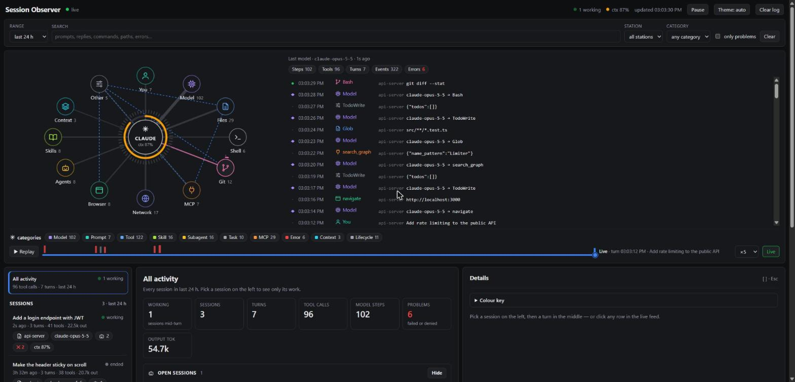
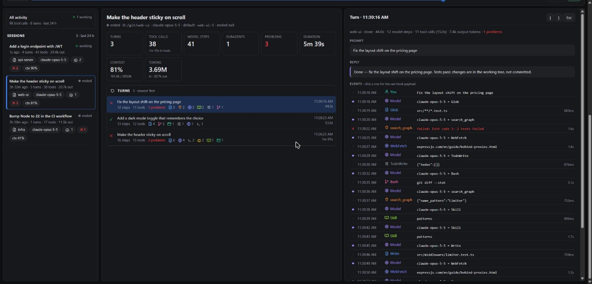
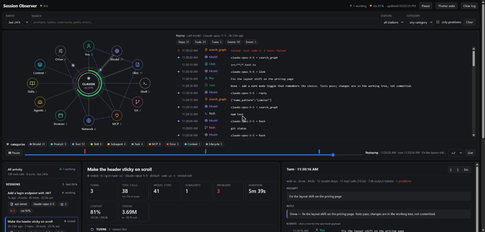

# Session Observer — a Claude Code plugin

See everything that happens in your Claude Code sessions on a live local dashboard:
prompts, every tool call (with timing), **skills loaded**, **questions Claude asks you**
(AskUserQuestion + MCP elicitations), subagents, tasks, MCP calls, permission prompts,
failures, notifications, context compactions, model switches, file/cwd changes, and
token usage per session.



> The live hub map (Claude in the centre, stations around it, pulses along the spokes) is
> based on [**lot-map** by alexeyw](https://github.com/alexeyw/lot-map). See [Credits](#credits).

## Quick start

Needs Node.js 18+ and Claude Code. No `npm install`.

```bash
git clone https://github.com/radekwojpl2/session-observer.git
claude --plugin-dir ./session-observer      # start Claude Code with the plugin loaded
```

Open **http://localhost:4777** (the server starts on the first session start), or run
`/session-observer:dashboard` inside Claude Code.

**Just want to look?** `node scripts/demo.js` serves made-up sessions, one of them still
working, on **http://localhost:4800**. It doesn't touch `~/.claude`.

| Session and turn details | Replaying an old turn |
|---|---|
|  |  |

## How it works

```
Claude Code ──(33 async hooks)──▶ scripts/hook.js ──▶ ~/.claude/session-observer/events.jsonl
                                                                │ (tailed)
                                    browser ◀──SSE── server/server.js (127.0.0.1:4777)
```

* **Zero dependencies** — plain Node.js (18+).
* **Never slows Claude down** — every hook is `async: true`, always exits 0.
* **Works even if the dashboard is closed** — events go to a JSONL file first; the
  server catches up when it starts.
* **Local only** — the server binds to `127.0.0.1`. Nothing leaves your machine.

## Install

**Try it without installing:**
```bash
claude --plugin-dir /path/to/session-observer
```

**Install via a local marketplace** (this folder is also a marketplace):
```
/plugin marketplace add /path/to/session-observer
/plugin install session-observer@session-observer-marketplace
```
Or straight from GitHub: `/plugin marketplace add radekwojpl2/session-observer`
(you need access to the repo while it's private).

Restart Claude Code after installing — hooks load at session start.

## Use

The server starts automatically on the first `SessionStart`. Open
**http://localhost:4777**, or run `/session-observer:dashboard` inside Claude Code.

Run it manually: `node server/server.js`.

Dashboard:
* filter bar — time range, full-text search, station, category, "only problems"
* top — **live hub map** (based on [lot-map](https://github.com/alexeyw/lot-map)): Claude in
  the centre with a context-window ring (amber ≥70 %, red ≥90 %), twelve stations around it
  (You, Model, Files, Shell, Git, MCP, Network, Browser, Agents, Skills, Context, Other).
  Every call pulses out along its spoke and back when it finishes (red on failure); spokes
  thicken with use; running calls get clock hands (1 min / 10 min); subagents orbit Agents;
  a dashed route joins the last stations visited; a ring leaves the core when a turn ends.
  Beside it, the live feed (● running · done ✕ failed ◆ model step), then category chips and
  a **replay** bar with one tick per turn — drag to scrub, ▶ Replay at ×1–×25, Live to return
* bottom left — "All activity" plus every session in range (working / live / ended)
* bottom middle — session stats and its turns (or, for All activity, open sessions and
  recent turns across projects)
* bottom right — the selected turn: prompt, reply, every event with its raw hook payload
  (`[` / `]` step through turns, `Esc` closes)

Model steps come from the session transcript (each assistant API response), since hooks
don't see them.

## What's captured

All hook events Claude Code exposes: `SessionStart, Setup, UserPromptSubmit,
UserPromptExpansion, PreToolUse, PermissionRequest, PermissionDenied, PostToolUse,
PostToolUseFailure, PostToolBatch, Notification, MessageDisplay, SubagentStart,
SubagentStop, TaskCreated, TaskCompleted, Stop, StopFailure, TeammateIdle,
InstructionsLoaded, ConfigChange, CwdChanged, DirectoryAdded, FileChanged,
WorktreeCreate, WorktreeRemove, PreCompact, PostCompact, PreModelSwitch,
PostModelSwitch, Elicitation, ElicitationResult, SessionEnd`.

Token usage comes from the session transcript (`transcript_path`), including subagent
transcripts, refreshed when a turn ends.

Not visible to hooks: Claude's thinking and streaming text mid-turn (the final message of
each turn is captured via `Stop`).

## Config (env vars)

| Variable | Default | |
|---|---|---|
| `OBSERVER_PORT` | `4777` | dashboard port |
| `OBSERVER_DATA_DIR` | `~/.claude/session-observer` | where `events.jsonl` lives |
| `OBSERVER_MAX_FIELD` | `8000` | max chars kept per string (file contents, outputs) |
| `OBSERVER_MAX_EVENTS` | `5000` | events kept in memory per session |
| `OBSERVER_AUTOSTART` | `1` | set `0` to stop SessionStart from launching the server |
| `OBSERVER_HOST` | `127.0.0.1` | bind address — keep it local |

## Privacy

The log holds your prompts, commands and tool outputs in plain text. Use **Clear log** in
the dashboard or delete `~/.claude/session-observer/events.jsonl`.

## Credits

The hub map section of the dashboard is based on
[**lot-map**](https://github.com/alexeyw/lot-map) by alexeyw (MIT), a Claude Code plugin that
draws a live map of the session beside the chat. Session Observer rebuilds its design in the
browser: the centre with a context-window ring, the stations around it, spokes that thicken with
use, a pulse out and back for each call, clock hands on running calls, subagents orbiting the
Agents station, the dashed route through recently visited stations, and the feed markers
(● running · done ✕ failed ◆ model step). No code was copied, but the design is theirs.
