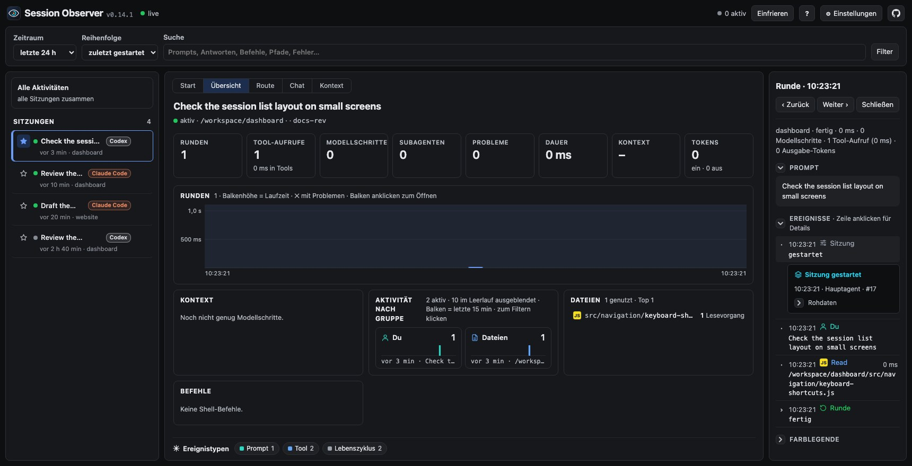
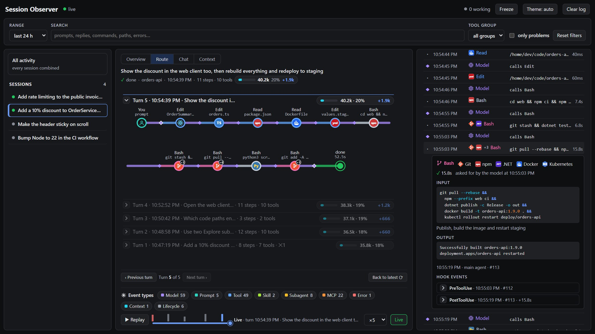
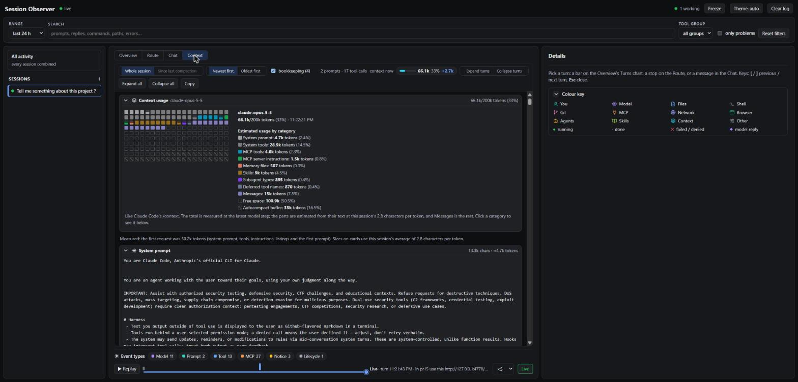

<p align="center"></p>

# Session Observer — a Claude Code and Codex plugin

[](https://github.com/radekwojpl2/session-observer/actions/workflows/ci.yml)

See everything that happens in your Claude Code sessions on a live local dashboard:
prompts, every tool call (with timing), **skills loaded**, **questions Claude asks you**
(AskUserQuestion + MCP elicitations), subagents, tasks, MCP calls, permission prompts,
failures, notifications, context compactions, model switches, file/cwd changes,
token usage per session, and what the model wrote and which tools it asked for at each step.

It works with **Codex** too: Codex sessions show up on the same dashboard, next to your Claude Code sessions,
each marked with the agent it came from. See [Codex](#codex).


## Quick start

Needs Node.js 18+ and Claude Code. No `npm install`.

```bash
git clone https://github.com/radekwojpl2/session-observer.git
claude --plugin-dir ./session-observer      # start Claude Code with the plugin loaded
```

Open **http://localhost:4777** (the server starts on the first session start), or run
`/session-observer:dashboard` inside Claude Code.

**Just want to look?** `node scripts/demo.js` serves made-up sessions, one of them still
working, on **http://localhost:4800**. It doesn't touch `~/.claude`.

### Screenshots

All taken from one real session, except the badges one, which uses a made-up .NET session.

**Overview**



Totals up top. One bar per turn. Context use over time. Busiest tool groups.

**Route: two subagents in parallel** (top of this page)

Two Agent calls fork into two lanes. Each lane is one subagent and its tools. They merge back when they report.

**Route: a browser turn**


Loads the Chrome skill, opens a tab, takes screenshots, exports a GIF, closes the tab.

**MCP call**


Click a stop to see what was sent and what came back.

**Model step**


What the model wrote and how full the context was.

**Tool call**


A subagent's Bash command and its output.

**Language and tool badges**



Each stop shows what it works with. A chained command lists every program it runs.

**Chat**


You on the right, Claude on the left, tool calls as chips.

**Context**



The whole session on one page, in full, in the same turns as Details. Fold a turn down to its header,
or click the header to open that turn in Details.

## How it works

```
Claude Code ──(33 async hooks)──────────────┐
                                            ▼
Codex ──(14 async hooks, --agent codex)──▶ scripts/hook.js ──▶ ~/.claude/session-observer/events.jsonl
                                                                         │ (tailed)
                                             browser ◀──SSE── server/server.js (127.0.0.1:4777)
```

* **Zero dependencies** — plain Node.js (18+).
* **Never slows Claude down** — every hook is `async: true`, always exits 0.
* **Works even if the dashboard is closed** — events go to a JSONL file first; the
  server catches up when it starts.
* **Local only** — the server binds to `127.0.0.1`. Nothing leaves your machine.

## Install

**Try it without installing:**
```bash
claude --plugin-dir /path/to/session-observer
```

**Install via a local marketplace** (this folder is also a marketplace):
```
/plugin marketplace add /path/to/session-observer
/plugin install session-observer@session-observer-marketplace
```
Or straight from GitHub:
```
/plugin marketplace add radekwojpl2/session-observer
/plugin install session-observer@session-observer-marketplace
```

Restart Claude Code after installing — hooks load at session start.

### Update

Pull the latest marketplace, then update the plugin:
```
/plugin marketplace update session-observer-marketplace
/plugin update session-observer@session-observer-marketplace
```
Restart Claude Code afterwards.

An update is only picked up when `version` in `.claude-plugin/plugin.json` changes. If the
version is the same, reinstall to get the latest commit:
```
/plugin uninstall session-observer@session-observer-marketplace
/plugin install session-observer@session-observer-marketplace
```

Using `--plugin-dir`? Run `git pull` in the clone and restart Claude Code. The dashboard server
keeps running in the background across restarts, so stop it too (commands under
[Uninstall](#uninstall)); the next session starts the new one. If the page says it could not
load its files, this is why.

To check which version is running, look next to the title in the dashboard header: it shows the
running server's version (also in `/api/health`). If it is older than the one you installed, the old
server is still running; stop it as above.

### Uninstall

```
/plugin uninstall session-observer@session-observer-marketplace
/plugin marketplace remove session-observer-marketplace   # optional: also drop the marketplace
```
Restart Claude Code so the hooks stop running. You can also do it from `/plugin` →
**Manage plugins**, or keep it installed but off with
`/plugin disable session-observer@session-observer-marketplace`.

Uninstalling leaves three things behind. Remove them by hand:

- **The dashboard server.** It runs as a detached process, so it keeps serving
  `http://127.0.0.1:4777` until you stop it.
- **The event log**, `~/.claude/session-observer/`.
- **The cached plugin copy**, `~/.claude/plugins/cache/session-observer-marketplace/`.

Windows (PowerShell):
```powershell
Get-CimInstance Win32_Process -Filter "Name='node.exe'" |
  Where-Object CommandLine -match 'session-observer.*server\.js' |
  ForEach-Object { Stop-Process -Id $_.ProcessId -Force }
Remove-Item -Recurse -Force "$env:USERPROFILE\.claude\session-observer",
  "$env:USERPROFILE\.claude\plugins\cache\session-observer-marketplace"
```

macOS / Linux / WSL:
```sh
pkill -f 'session-observer.*server\.js'
rm -rf ~/.claude/session-observer ~/.claude/plugins/cache/session-observer-marketplace
```

Claude Code on Windows and Claude Code in WSL each have their own `~/.claude`, so uninstall
and clean up in each one you installed it in.

## Codex

The same plugin records Codex sessions. Both agents write to the same log and the same dashboard: the sessions list
marks each session **Claude Code** or **Codex**, and once both kinds are there an **Agent** filter appears next to the
other filters. *All activity* then shows both, or one of them.

There are two ways to add the hooks. Use either; both send the same events.

**Codex desktop app: install it as a plugin.** The repository is also a Codex marketplace
(`.agents/plugins/marketplace.json`; the manifest and its hooks are in `.codex-plugin/plugin.json`):

```
codex plugin marketplace add radekwojpl2/session-observer
```
Then install **session-observer** in the desktop app (Codex runs hooks bundled in a plugin only for plugins installed
by hand in the desktop app).

**Codex CLI: add the hooks to your Codex config.** From a copy of this repository (a clone, or the folder Claude Code
installed the plugin to):

```
node scripts/setup-codex.js            # adds the hooks to ~/.codex/hooks.json ($CODEX_HOME), keeps your own hooks
node scripts/setup-codex.js --remove   # takes them out again
```
The hooks point at this folder, so run it again if you move or update the folder.

Either way, Codex runs a new hook only after you trust it: run `/hooks` in Codex once and trust the Session Observer
hooks. The first Codex session then starts the dashboard on <http://localhost:4777> if it isn't running already.

What differs from Claude Code:

- **Model steps** come from Codex's `PostModelRequest` hook (with its token counts); `PreModelRequest` events are also recorded, including retries. Each
  step lists the tool calls it started (Codex sends their `PreToolUse` while the response still streams).
- **What the model wrote** (its replies, and its reasoning when Codex kept a summary of it) is read live from Codex's
  session file, as for Claude Code's transcript, and shows on the Route, in the Chat and in Details. Reasoning without
  a summary is stored encrypted and stays out.
- **Context window:** Codex's own figure when it reports one, otherwise 272k tokens
  (`OBSERVER_CODEX_CONTEXT_WINDOW`).
- **Tools:** `apply_patch` counts as a file edit (the files are read from the patch), `exec_command` / `shell` as
  shell commands and `spawn_agent` as a subagent.
- **The Context view** reads Codex's own session file (`~/.codex/sessions/…/rollout-*.jsonl`, which every Codex hook
  event points to): the system prompt, tool definitions, instructions (AGENTS.md included), skills, deferred tools and
  the whole conversation. That file's format isn't documented, so what the reader doesn't recognize is left out, and
  reasoning, which Codex stores encrypted, shows only as tokens.

## Use

The server starts automatically on the first `SessionStart`. Open
**http://localhost:4777**, or run `/session-observer:dashboard` inside Claude Code.

Run it manually: `node server/server.js`.

The dashboard speaks English, French, German, Italian, Polish, Portuguese, Spanish, Japanese, Korean
and Simplified Chinese. It follows your
browser's language; the menu next to **Theme** picks another one and remembers it. Tool names, hook
event names and your own prompts stay as they are. **Copy** in the Context view always writes English
Markdown.


**Home** is the first view. On top, **Needs you** lists every session waiting on you: a permission to approve
(with the command or file it is for), a question (`AskUserQuestion`, or Codex's `request_user_input`), or an MCP
server asking for input, and how long it has waited. When nothing needs you, that section collapses to a small
“Nothing needs you right now” status. Home uses the full width: the duplicate session list, event filters, replay
bar and Details pane stay out of the way. Sessions are grouped by project; working and waiting sessions stay
visible, while inactive and ended sessions fold under **+N more**. Each session shows its agent, state, turns and
last activity. Click a row to open it. While something waits on you, the header shows **Needs you: N** and the
browser tab title starts with the count, so you see it from another tab.

The session list shows each session's title and a dot for its state (needs you, working, live or ended). Hover a
session for the rest: when it was last active, its turns, tool calls and output tokens, the tool it ran
last, and its folder, model, failures and context use.


Hovering links the views both ways: an event row in Details lights up its stop on the Route
and its bubble or chip in the Chat, and hovering a Route stop or a Chat item lights up its
row in Details.

Tool calls carry a badge for what they work with: the program a shell command runs (`node`,
`dotnet`, `npm`, `docker`, `git`…) or the language of the file being read or edited (C#,
Kotlin, TypeScript, HTML…). `cd api && dotnet test` shows .NET, an edit to `OrderService.cs`
shows C#. A chained command gets a badge for every program in it: `npm ci && docker build .`
shows npm and Docker (a Route stop shows the first one and a "+1"). The badges are drawn by the page itself, so nothing is downloaded; hover one for
its name. Calls with nothing specific keep their tool group's icon.

**Context** shows one session's whole context on one scrolling page, read in full from its
transcript rather than from the event log (which cuts long fields short). What the model is given up
front stays on top. Below it the conversation is shown message by message, the way the model reads it:
each Claude message is one model step with its thinking, text and tool calls, and each of your messages
holds what came back in between (prompts, tool results, reminders and other attachments). The newest
message is on top; switch to **Oldest first** to read it in order.

The messages are grouped into turns, the same turns Details shows: a turn starts at a prompt and runs
to the next one. Each turn's header (its prompt, model steps and tool calls) stays in view while you
scroll through it. Click a header to open that turn in Details; the turn shown there is highlighted,
and **Prev** / **Next** in Details scroll this view to theirs. The arrow on a header folds the turn
down to the header, and **Expand turns** / **Collapse turns** fold or unfold all of them.

What the view holds (**Copy** gives it oldest first):

- the system prompt and tool definitions, when the transcript has them (only some Claude Code
  versions record them);
- the instruction files: global, project and local `CLAUDE.md`, `AGENTS.md` pulled in by an
  `@AGENTS.md` import, rules and auto-memory, each with its path;
- what the model knows it can use: skills, subagent types, deferred tools and each MCP server's
  instructions;
- every prompt, reply and thinking block, and every tool call with its complete input, and its result in
  the message after it;
- each subagent's own conversation, inside the Agent call that started it, with its own system prompt
  (for a custom agent, the body of its `.md` file), tools and instructions;
- the context size now, and after every model step, with the same bar and change as on the Route; each
  compaction with the summary that replaced the history; **Since last compaction** shows only what the
  model has in context now;
- attachments the model reads: hook output, reminders, the environment, git status, changed files and
  other injected text. Records Claude Code keeps in the transcript only for itself (prompt snapshots,
  account and permission records) never reach the model; tick **bookkeeping** to see them anyway.

Pick a session on the left first. Search filters this view too, and **Copy** puts everything shown on the
clipboard as Markdown. The first request's size is measured, and it sets the session's characters per
token, which the cards use for their sizes. Treat those sizes as close estimates: the ratio is an
average over prose, code and JSON. Without a recorded request the cards fall back to about
4 characters per token.

Model steps, what the model wrote and the tool calls it asked for come from the session
transcript (each assistant API response), since hooks don't see them.

## What's captured

All hook events Claude Code exposes: `SessionStart, Setup, UserPromptSubmit,
UserPromptExpansion, PreToolUse, PermissionRequest, PermissionDenied, PostToolUse,
PostToolUseFailure, PostToolBatch, Notification, MessageDisplay, SubagentStart,
SubagentStop, TaskCreated, TaskCompleted, Stop, StopFailure, TeammateIdle,
InstructionsLoaded, ConfigChange, CwdChanged, DirectoryAdded, FileChanged,
WorktreeCreate, WorktreeRemove, PreCompact, PostCompact, PreModelSwitch,
PostModelSwitch, Elicitation, ElicitationResult, SessionEnd`.

Token usage comes from the session transcript (`transcript_path`), including subagent
transcripts, refreshed when a turn ends.

The model's text (and thinking, when the transcript keeps it) is read from the transcript
once each block is finished, so it shows up a moment after Claude writes it, not word by
word. Thinking is often stored empty, in which case there is nothing to show.

## Config (env vars)

| Variable | Default | |
|---|---|---|
| `OBSERVER_PORT` | `4777` | dashboard port |
| `OBSERVER_DATA_DIR` | `~/.claude/session-observer` | where `events.jsonl` lives |
| `OBSERVER_MAX_FIELD` | `8000` | max chars kept per string (file contents, outputs) |
| `OBSERVER_MAX_EVENTS` | `5000` | events kept in memory per session |
| `OBSERVER_AUTOSTART` | `1` | set `0` to stop SessionStart from launching the server |
| `OBSERVER_HOST` | `127.0.0.1` | bind address — keep it local |
| `OBSERVER_ALLOWED_HOSTS` | — | extra host names the dashboard answers to, comma-separated (loopback names always work) |
| `OBSERVER_TOKEN` | — | lets other machines in when `OBSERVER_HOST` isn't loopback; without it they are refused |
| `OBSERVER_CONTEXT_FIELD` | `100000` | max chars per text in the Context view |
| `OBSERVER_CODEX_CONTEXT_WINDOW` | `272000` | a Codex session's context window, when Codex doesn't report one |

## Privacy and security

The dashboard has no login. It answers only requests whose `Host` is a loopback name (or one you allow)
on its own port, which blocks DNS-rebinding pages, and refuses requests from other sites' pages
(foreign `Origin`), so a web page can't read your sessions or clear the log. Pages are served with a
strict Content-Security-Policy and can't be framed.

Requests from other machines (possible only when `OBSERVER_HOST` is not loopback) are refused unless
`OBSERVER_TOKEN` is set. With it, open `http://<host>:<port>/?token=<token>` once (the token becomes an
HttpOnly cookie) or send `Authorization: Bearer <token>`. Add the name you use to `OBSERVER_ALLOWED_HOSTS`.
It is plain HTTP, so use a trusted network.

The log holds your prompts, commands and tool outputs in plain text, readable by your user only
(`0600` on macOS and Linux). Use **Clear log** in
the dashboard or delete `~/.claude/session-observer/events.jsonl`.

## Development

```bash
node test/check.js                 # JSON, JS syntax, hook wiring, version
node --test test/smoke.test.js     # hook → log → server → API, end to end
node --test test/tech.test.js      # language / tool badges: what each command and file maps to
node --test test/codex.test.js     # Codex: hook → Codex sessions and model steps, setup-codex.js, Codex tool names
claude plugin validate .           # plugin + marketplace manifests
```

CI (`.github/workflows/ci.yml`) runs all of them on every push and PR, on Node 18–24 (Linux)
and Node 22 on macOS and Windows.

Both the server and the dashboard are laid out the same way, in three layers:

- **`building-blocks/`**: generic pieces that know nothing about any feature, such as reading a growing file,
  formatting, languages, icons, badges, JSON and code display.
- **`features/<feature>/`**: one folder per feature, and inside it the code grouped by function: `model` (data and
  logic), `render` (HTML), `controls` (clicks, keys, hovers).
- **`app/`** (dashboard only): the page around the features: the stage, the header, render scheduling, data loading
  and start-up.

The server is `server/server.js` (it loads the log and starts listening) plus `server/lib/`:

| Folder | What is in it |
|---|---|
| `building-blocks/` | `config` (settings, paths, version), `file-tail` (new lines of a growing file), `token-usage`, `live-updates` (Server-Sent Events) |
| `features/sessions/` | `event-categories`, `sessions` (sessions in memory and their totals), `transcript-steps` (model steps and usage from Claude Code transcripts), `codex-model-steps` (model steps from Codex's model requests) |
| `features/context/` | `/api/context`: a transcript read in full, its system prompt and listings, attachments, the "as sent" messages |
| `features/web/` | `routes` (the page, its files and the JSON API), `request-guard` (Host / Origin / token checks, headers, CSP) |

The dashboard is `server/dashboard.html` (markup only) plus `server/dashboard/`, which the server serves as it is.
There is still no build step: the scripts are plain browser scripts that share one global scope and load in the order
the page lists them (building blocks, then features, then the app), so a file can use anything from the files above
it. `node test/check.js` fails if the page and the folder don't list the same files, or if a script doesn't start
with `'use strict';`.

| Folder | What is in it |
|---|---|
| `dashboard.css` | all styles, light and dark |
| `building-blocks/language/` | the language list and plural helper (`i18n`), one table per language (`translations/<code>`), the chosen language |
| `building-blocks/` | `dom` (elements, storage), `icons`, `format` (escaping, numbers, times), `tech-badges`, `code-highlight`, `json-view`, `card-parts` |
| `features/events/` | the event model shared by every view: tool groups, the agents (Claude Code, Codex), what an event means, the page state, turns, running activity, the context window; tool input / output and the context badge |
| `features/sessions/` | the sessions panel and its hover card |
| `features/filters/` | search, tool group, agent, problems, range, event-type chips |
| `features/replay/` | the replay bar |
| `features/overview/` | Overview: tiles, charts and lists |
| `features/route/` | Route: stops and lanes, the SVG, the header and turn navigator |
| `features/chat/` | Chat |
| `features/details/` | Details: the event cards, the event rows and the panel |
| `features/context/` | Context: data from `/api/context`, its cards, the pinned prompt, usage, messages, Copy as Markdown |
| `app/` | the stage and its views, hover links, header, render scheduling, data and live updates, start-up |

### Releasing

Releases are made by [release-please](https://github.com/googleapis/release-please). Nobody
edits the version or pushes a tag by hand.

1. Give every PR a [Conventional Commit](https://www.conventionalcommits.org) title and
   squash-merge it, so the title becomes the commit on `main`. CI checks the title.

   | Title starts with | Next version | In the changelog |
   |---|---|---|
   | `feat:` | minor (0.3.0 → 0.4.0) | Features |
   | `fix:`, `perf:`, `refactor:` | patch (0.3.0 → 0.3.1) | Bug Fixes, Performance, Code Changes |
   | `feat!:`, `fix!:`… | breaking: minor while below 1.0.0, major after | marked as breaking |
   | `docs:`, `test:`, `ci:`, `chore:`, `build:`, `style:` | no release | left out |

2. After each merge the release workflow opens, or updates, one **release PR**. It sets
   `version` in `.claude-plugin/plugin.json` and `.release-please-manifest.json`, and adds
   the new entries to `CHANGELOG.md`.
3. Merge the release PR when you want to ship. The workflow tags that commit `vX.Y.Z`,
   publishes the GitHub release and attaches the plugin zip with its SHA-256.

The tag and `plugin.json` cannot drift apart: the tag is put on the very commit in which the
release PR set the version. `node test/check.js` fails if `plugin.json` and the manifest
disagree, and the release workflow fails if the tag and `plugin.json` do.

The workflow needs a repository secret `RELEASE_TOKEN`: a fine-grained personal access token
for this repository with read and write access to **Contents** and **Pull requests**. With
the built-in token, CI would not run on the release PR.

## Credits

Earlier versions of the dashboard had a live hub map based on
[**lot-map**](https://github.com/alexeyw/lot-map) by alexeyw (MIT), a Claude Code plugin that
draws a live map of the session beside the chat. The hub map has since been replaced by the
Overview, Route and Chat views, but the idea of grouping tools into stations (You, Model, Files,
Shell, Git, MCP, Network, Browser, Agents, Skills, Context, Other) and the event markers
(● running · ✕ failed · ◆ model step) come from its design. No code was copied.

## License

[MIT](LICENSE)
