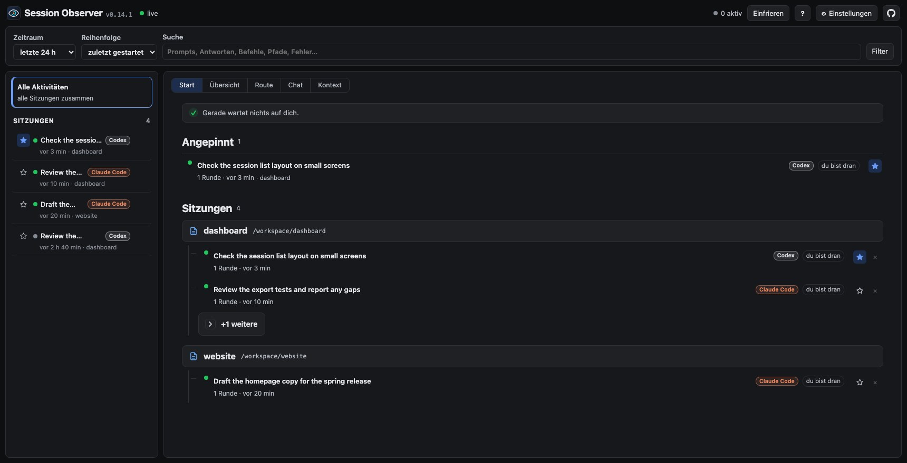
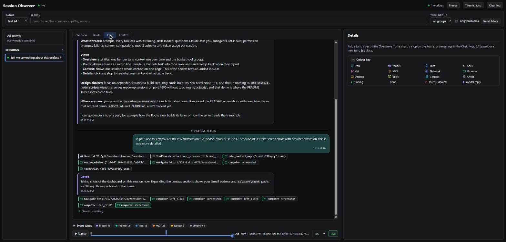
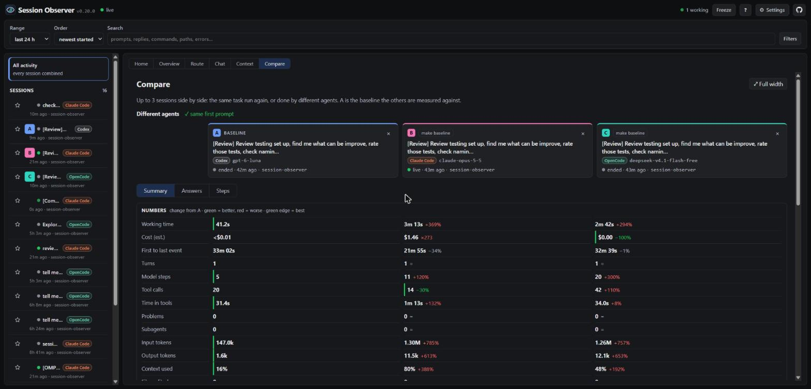

<p align="center"></p>

# Session Observer

**One local dashboard for Claude Code, Codex and OpenCode.** Follow prompts, tool calls, model steps, subagents, context use and failures as they happen.

[](https://github.com/radekwojpl2/session-observer/actions/workflows/ci.yml)
[](https://github.com/radekwojpl2/session-observer/releases)
[](https://github.com/radekwojpl2/session-observer/stargazers)
[](LICENSE)
[](#install)
[](#install)
[](#opencode)
[](#development)
[](https://github.com/radekwojpl2/session-observer/commits/main)

## Screenshots

The Home and Overview screenshots use example sessions. The remaining screenshots come from real Claude Code and Codex sessions. The numbered labels were added for this README; the dashboard doesn't show them.



*Home: pinned sessions above the project tree. Click a session's star on Home or in the left session list to pin or unpin it. Pinned sessions stay above other sessions in their group and remain visible outside the selected date range.*


*Overview: totals, one bar per turn, context use and activity. Click a bar to open the turn.*


*Route: follow a turn through tool calls and parallel subagents. Click a stop to see its input and output.*



*Chat: prompts, thinking, tool chips and replies in order.*


*Context: what fills the context window, down to each record.*



*Compare: up to three sessions side by side, each measured against the first.*

## How it works

~~~mermaid
flowchart LR
  C[Claude Code] -->|plugin hooks| H[scripts/hook.js]
  X[Codex] -->|plugin hooks or CLI config| H
  O[OpenCode] -->|in-process plugin| P[capture/plugin.js]
  P -->|append by day and session| L
  H -->|append by day and session| L[(~/.claude/session-observer/sessions/DAY/*.jsonl)]
  L -->|recent days at start, older on request| S[Local Node server]
  S -->|HTTP and live updates| D[Dashboard in your browser]
  S -. reads transcript when needed .-> T[Claude transcript, Codex rollout or opencode.db]
~~~

Each integration appends every event to a JSONL file for its session inside a folder for the current UTC day. The server keeps sessions in memory. At start it reads only the last few days, and the dashboard can load older days on request. The dashboard labels sessions by agent and reads transcripts when a view needs message or context detail.

### Event storage

One file per session, in the folder of the UTC day it was last active.

```
~/.claude/session-observer/
  sessions/<YYYY-MM-DD>/<sha256(session_id)>.jsonl
  deleted-sessions.jsonl   ← deleted session ids, so they are not imported again
  events.jsonl             ← written only by older plugin versions; imported at start
```

**Hook: append, moving the file forward to today**

~~~mermaid
flowchart TD
  E([hook event]) --> T{today's file exists?}
  T -->|yes| A[append]
  T -->|no| O{file in an earlier day?}
  O -->|no| N[create today's file] --> A
  O -->|yes| M[move it to today, remove the empty folder] --> A
  M -.->|rename refused: file locked on Windows| A2[append where it is, retry on the next event]
~~~

**Server: read recent days, follow moved files**

~~~mermaid
flowchart TD
  S([start]) --> I[import events.jsonl into day folders, skip deleted ids]
  I --> W[read the last OBSERVER_LOAD_DAYS days]
  W --> P[every 400 ms: read new bytes of each file]
  P -->|same file in a newer folder| K[keep the read offset]
  P --> D[push events to the dashboard]
  W -->|Load sessions before …| O[read older days]
~~~

- **Delete (×):** removes the session's file and adds its id to `deleted-sessions.jsonl`.
- **Midnight race:** a new session can get two files; the server reads them in order.

<details>
<summary>Alternatives considered</summary>

| Approach | Why not |
|---|---|
| One combined `events.jsonl` | Every start reads everything; deleting a session rewrites the file |
| Per-session files, flat | Every start reads every session ever |
| Per-session files + SQLite | Needs Node 22.13; two sources of truth; the hook would wait on a lock |
| Day files shared by all sessions | Deleting a session rewrites every day file it is in |
| Per-session files split at midnight | The server must merge a session's days |

</details>

## Install

Needs Node.js 18 or newer. There is no npm install and no build step.

### Claude Code

The plugin installs Claude Code hooks and starts the dashboard when a session begins.

From a local clone:

~~~sh
claude --plugin-dir ./session-observer
~~~

Or install from the marketplace:

~~~text
/plugin marketplace add radekwojpl2/session-observer
/plugin install session-observer@session-observer-marketplace
~~~

Restart Claude Code after installing so the hooks load.

To update later, run `/session-observer:update` in Claude Code. It updates the marketplace and the plugin (reinstalling if the version did not change), stops the old dashboard server and starts the new one.

#### Optional: report the exact Claude Code context window

Claude Code sends the active model's actual context window to its [status line command](https://code.claude.com/docs/en/statusline#context-window-fields). To share that size with Session Observer, pipe the status line input through the filter from a local checkout. In your Claude Code `settings.json`, prepend the filter to your existing `statusLine.command`. For example:

```json
{
  "statusLine": {
    "type": "command",
    "command": "node \"/absolute/path/to/session-observer/scripts/claude-statusline.js\" | sh \"$HOME/.claude/statusline.sh\""
  }
}
```

The filter passes the original input through to your existing command. It saves only the model ID and window size in `context-windows/` under the dashboard data directory, keyed by a hash of the session ID. Session Observer keeps estimating the window for sessions without a matching report.

### Codex

Codex can load the hooks as a desktop plugin or from its CLI hook config.

**Codex desktop app:** add the marketplace, then install Session Observer in the desktop app. Adding a marketplace alone does not activate its hooks:

~~~sh
codex plugin marketplace add radekwojpl2/session-observer
~~~

**Codex CLI:** from this repository, add the hooks to your Codex config:

~~~sh
node scripts/setup-codex.js
~~~

The setup script keeps your existing hooks. Run it again if you move this repository. To remove only these hooks, run:

~~~sh
node scripts/setup-codex.js --remove
~~~

On first use, open /hooks in Codex and trust the Session Observer hooks. The dashboard starts on the first session if it is not already running.

### OpenCode

OpenCode has no hook commands, so Session Observer adds a plugin that runs inside it. From this repository:

~~~sh
node scripts/setup-opencode.js
~~~

This writes `session-observer.js` into OpenCode's plugin folder (`~/.config/opencode/plugin/`, or under `$XDG_CONFIG_HOME`). Restart OpenCode afterwards. Run it again if you move this repository. To remove it:

~~~sh
node scripts/setup-opencode.js --remove
~~~

The plugin starts the dashboard with the `node` on your PATH. What it records, passes through or leaves out: [server/lib/features/agents/opencode/FIDELITY.md](server/lib/features/agents/opencode/FIDELITY.md).

## Claude Code, Codex and OpenCode: what differs

| | Claude Code | Codex | OpenCode |
|---|---|---|---|
| Hook setup | Installed with the Claude Code plugin | Desktop plugin or CLI setup script | Plugin setup script |
| Event source | Claude Code hook events | Codex hook events, including model request and usage events | Its plugin hooks and bus events, translated; each keeps OpenCode's own event |
| Message and context source | Claude session transcript | Codex rollout file in ~/.codex/sessions | The plugin: steps, tokens, replies and the system prompt as they happen |
| Context detail | Transcript, instructions, tools, skills and attachments when recorded | Rollout parser reads prompts, replies, tool activity and context metadata | OpenCode's own database (`opencode.db`, read-only, Node 22.5+): prompts, replies, reasoning, tool calls with full output, steps, subagents. Tool definitions aren't stored there |
| Subagents | In the same session | In the same session | A session of their own, linked to the task call that started it |
| Reasoning | Shown when the transcript provides it | Codex stores reasoning encrypted; only available summaries are readable | In the Context view, from its database |
| Dashboard | Same local dashboard and event log | Same local dashboard and event log | Same local dashboard and event log |

## Tricky details

- **Hooks stay out of the way.** The hook writes events quickly, swallows errors and exits successfully so it does not block the coding session.
- **Remove one session's Observer data.** Use its × button on Home or in the session list to delete its JSONL file. If the agent is still running, later events can create a new entry. Its original transcript, rollout or OpenCode session is not deleted.
- **The sessions are not merged.** Claude Code, Codex and OpenCode sessions share a dashboard, but each keeps its own transcript and session identity.
- **Agents started by agents are linked.** When Claude Code runs `codex exec`, or Codex runs `claude -p`, the new session nests under the one that started it on Home, Overview says "started by", and the call that started it links to it. The hook reads the parent from the environment: `CLAUDE_CODE_SESSION_ID`, or `CODEX_SESSION_ID` with `CODEX_TOOL_CALL_ID`. Claude Code started by Claude Code is not linked: Claude Code replaces that variable with its own id.
- **Codex hooks need trust.** Trust them once in Codex with /hooks. The CLI script preserves your other hooks, but its paths point to this clone.
- **Context sizes are estimates.** Transcript formats and token counts differ by agent. Codex's rollout format is undocumented and may change; encrypted reasoning text cannot be recovered by the dashboard.

## Privacy and stored data

Session Observer writes hook events to `~/.claude/session-observer/sessions/<day>/<session-hash>.jsonl`. At each start, the server moves the former combined `events.jsonl` into these folders. Until their plugin is updated, older installed hooks keep appending to that file, and the server tails it. `deleted-sessions.jsonl` keeps the ids and times of deleted sessions, so that import skips them. Session logs can contain prompts, commands and tool output. The server binds to `127.0.0.1` by default and reads Claude transcripts, Codex rollouts or OpenCode's `opencode.db` (read-only) locally when needed. Treat them as sensitive.

To clear Observer's event history, stop the server and delete the `sessions` directory, `events.jsonl` and `deleted-sessions.jsonl` from the configured data directory. To drop only old history, delete the day folders you no longer need (`~/.claude/session-observer` by default). This does not delete the original Claude or Codex transcripts, or OpenCode's own sessions.

## Troubleshooting

- **No sessions appear:** start a new Claude Code, Codex or OpenCode session after installing. For Codex, open `/hooks` and trust Session Observer; for Codex CLI, rerun `node scripts/setup-codex.js` if you moved the repository. For OpenCode, restart it after setup, and rerun `node scripts/setup-opencode.js` if you moved the repository.
- **The dashboard does not open:** start it with `node server/server.js`. If port 4777 is already in use, start it on another port:

  ~~~powershell
  $env:OBSERVER_PORT=4778; node server/server.js
  ~~~

  In Command Prompt, use `set OBSERVER_PORT=4778&& node server/server.js`.
- **Events appear, but transcript details are missing:** transcript and context views read the source app's local transcript or rollout. Confirm the file is available to the same user running the dashboard.

## Uninstall

- **Claude Code:** open `/plugin` and uninstall Session Observer from the installed plugins.
- **Codex desktop:** remove Session Observer from the app's plugin manager.
- **Codex CLI:** from the repository, run `node scripts/setup-codex.js --remove` before deleting or moving the clone. This removes only Session Observer hooks and keeps your other hooks.

To remove saved Observer events as well, stop the server and delete the event files described above.

## Use

The first session starts the server automatically. Open [http://localhost:4777](http://localhost:4777). To start it manually:

~~~sh
node server/server.js
~~~

Try a synthetic demo without writing to your real event log:

~~~sh
node scripts/demo.js
~~~

The demo opens at http://localhost:4800.

### Compare sessions

Run the same task again, or give it to another agent, then compare the runs. Click the compare button beside a session in the left list (it shows on hover), or open **Compare** and add sessions from its menu. You can compare up to three sessions. The first one, **A**, is the baseline. Every other value shows its change from A: green when it is lower (less time, fewer tokens, fewer problems), red when it is higher. Click **make baseline** on another session to measure against it instead.

Compare shows what each session cost (see [Cost estimates](#cost-estimates)), each session's first prompt and last reply, its tool calls by group, the files each one edited, and each turn's duration and cost side by side. Click a turn (or **Open all**) to list every step of it for each session in columns: each model step with what it cost, what the model wrote, and each tool call with its file or command, how long it took and whether it failed. File paths are read from each session's own folder, so runs in different worktrees line up. Your selection is kept in the page address (`?compare=`), so a reload or a bookmark keeps it.

### Desktop notifications

Choose **Notify** under **⚙ Settings** in the header to get a desktop notification when a session needs you (a permission, a question, an MCP server asking), and optionally when a turn finishes. The browser asks for permission the first time. Notifications appear only while the dashboard window is not focused. Click one to open that session.

### Keyboard shortcuts

Press **?** (or the **?** button in the header) for the list. **j** / **k** (or **]** / **[**) step through the turns, **Shift+J** / **Shift+K** through the sessions, **0** goes to All activity, **u** to the next session that needs you, **Esc** closes the turn, **/** goes to the search, and **1**–**6** switch between Home, Overview, Route, Chat, Context and Compare. The same dialog has a tab with common Claude Code keys, linked to its docs.

### Dashboard languages

The dashboard follows your browser language. Choose another under **⚙ Settings** in the header; the selection is saved.

| Code | Language |
|---|---|
| en | English |
| de | Deutsch |
| es | Español |
| fr | Français |
| it | Italiano |
| ja | 日本語 (Japanese) |
| ko | 한국어 (Korean) |
| pl | Polski |
| pt | Português |
| zh | 简体中文 (Chinese, Simplified) |

Want another language? [Open an issue to request one](https://github.com/radekwojpl2/session-observer/issues/new).

## Config

| Variable | Default | Purpose |
|---|---:|---|
| OBSERVER_PORT | 4777 | Dashboard port |
| OBSERVER_DATA_DIR | ~/.claude/session-observer | Event log directory |
| OBSERVER_AUTOSTART | 1 | Set to 0 to disable automatic start |
| OBSERVER_HOST | 127.0.0.1 | Bind address |
| OBSERVER_MAX_EVENTS | 5000 | Events kept per session |
| OBSERVER_LOAD_DAYS | 7 | Days of session folders read at start, today included; 0 reads every day |
| OBSERVER_CONTEXT_FIELD | 100000 | Maximum characters shown per context field |
| OBSERVER_CODEX_CONTEXT_WINDOW | 272000 | Fallback Codex context window, in tokens |

### Cost estimates

Overview and Compare show what a session cost at the model maker's API prices. Each model step is priced from its tokens: input, output, cache reads, and cache writes. Claude's 1-hour cache writes cost more than 5-minute ones and are priced separately. Prompts above a model's long-context threshold use the higher price. OpenCode reports what each step cost, and that figure is used as it is.

It is an estimate. On a subscription such as Claude Max or ChatGPT Plus you don't pay per token, but the estimate still compares runs fairly. A model with no known price shows **–**. A total that leaves out such steps is marked **\***.

The built-in prices come from the [Anthropic](https://platform.claude.com/docs/en/about-claude/pricing) and [OpenAI](https://developers.openai.com/api/docs/pricing) pricing pages (November 2026), in `server/lib/features/cost/prices.js`. To add a model or correct a price, create `prices.json` in the data directory (`~/.claude/session-observer/` by default) and restart the server. Prices are USD per million tokens. `input` and `output` are required. A missing cache price falls back to the input price.

~~~json
{
  "deepseek-v4.1-flash": { "input": 0.3, "output": 1.2, "cache_read": 0.03 },
  "claude-opus-5-5": { "input": 4, "output": 20, "cache_read": 0.2, "cache_write": 5, "cache_write_1h": 8 }
}
~~~

## Development

~~~sh
node test/check.js
node --test test/*.test.js
~~~

To contribute, read [CONTRIBUTING.md](CONTRIBUTING.md): changes come from forks, and each pull request links an issue and includes annotated proofs.

## License

[MIT](LICENSE)
